


  
  
  
  
  

<!-- KPIS:START · generated by .github/scripts/build_profile.py: each number links to where it is measured -->

  <a href="https://github.com/akeanti/swingbus/blob/main/docs/validation.md"></a><!--
  --><a href="https://github.com/akeanti/swingbus#n-1-screening-of-the-ieee-118-bus-system"></a><!--
  --><a href="https://github.com/akeanti/ariadne/blob/main/docs/results.md#reliability"></a><!--
  --><a href="https://github.com/akeanti/malfoid#how-recognition-works"></a><!--
  --><a href="#proof"></a>

<b>Where each number comes from</b>, with the CI state of every repo behind it, live

 

<table>
<tr><th>Claim</th><th>Measured in</th><th>CI now</th></tr>
<tr><td>1e-13 pu match with the PYPOWER reference</td><td><a href="https://github.com/akeanti/swingbus/blob/main/docs/validation.md">swingbus, docs/validation.md: every case against PYPOWER, re-run by tests/test_oracle.py</a></td><td><a href="https://github.com/akeanti/swingbus/actions">swingbus</a> tests passing</td></tr>
<tr><td>8.3 ms full N-1 screen of a 118-bus grid</td><td><a href="https://github.com/akeanti/swingbus#n-1-screening-of-the-ieee-118-bus-system">swingbus README: N-1 screening of the IEEE 118-bus system, 186 outages</a></td><td><a href="https://github.com/akeanti/swingbus/actions">swingbus</a> tests passing</td></tr>
<tr><td>2.4× faster maze runs with clothoid turns</td><td><a href="https://github.com/akeanti/ariadne/blob/main/docs/results.md#reliability">ariadne, docs/results.md: same physics model and control law, four mazes</a></td><td><a href="https://github.com/akeanti/ariadne/actions">ariadne</a> tests passing</td></tr>
<tr><td>99.6% top-1 gesture recognition on-device</td><td><a href="https://github.com/akeanti/malfoid#how-recognition-works">malfoid README: thousands of synthetic sloppy casts; CI fails if the score drops</a></td><td><a href="https://github.com/akeanti/malfoid/actions">malfoid</a> tests passing</td></tr>
<tr><td>230+ automated tests in CI across 4 repos</td><td>the CI of swingbus, ariadne, malfoid and cascade-gnn</td><td><a href="https://github.com/akeanti/swingbus/actions">swingbus</a> tests passing · <a href="https://github.com/akeanti/ariadne/actions">ariadne</a> tests passing · <a href="https://github.com/akeanti/malfoid/actions">malfoid</a> tests passing · <a href="https://github.com/akeanti/cascade-gnn/actions">cascade-gnn</a> tests passing</td></tr>
</table>

<!-- KPIS:END -->

<!-- PINNED:START · generated by .github/scripts/build_profile.py from my GitHub pins -->

  <a href="https://github.com/akeanti/cascade-gnn"></a>
  <a href="https://github.com/akeanti/swingbus"></a>

  <a href="https://github.com/akeanti/nabd"></a>
  <a href="https://github.com/akeanti/matlab-discord-rpc"></a>

  <a href="https://github.com/akeanti/ariadne"></a>
  <a href="https://github.com/akeanti/malfoid"></a>

<!-- PINNED:END -->



<!-- LIVE:START · generated by .github/scripts/build_profile.py from the data in my other repos -->

  <a href="https://akeanti.xyz/ariadne/#race"></a>
  <a href="https://akeanti.xyz/malfoid/#spellbook"></a>

<!-- LIVE:END -->



<a href="https://github.com/akeanti/akeanti/raw/main/cv/Elmehdi_Essamit_CV.pdf"></a>

  
  
  

<!-- TEXT:START · generated by .github/scripts/build_profile.py from the same facts as the graphics -->

<b>Read this profile as plain text</b> · for search, screen readers and copy-paste

 

<b>Elmehdi Essamit</b> (akeanti) · élève-ingénieur, first year, Electrical and Energy Engineering, EHTP · Casablanca, Morocco 
Power grids, energy and embedded systems. From the ESP32 sensor to the grid solver, every result checked against a reference.

<b>Looking for</b> a stage d'initiation (first-year internship): summer 2027, 1 to 2 months, dates on request; Morocco or abroad, on-site, hybrid or remote. Fields: power and energy systems; studies, operations, maintenance, automation. 
<b>Contact</b> essamit.elmehdi@proton.me · <a href="https://elmehdi-essamit.com">elmehdi-essamit.com</a> · <a href="https://www.linkedin.com/in/elmehdi-essamit">linkedin.com/in/elmehdi-essamit</a> · <a href="https://github.com/akeanti/akeanti/raw/main/cv/Elmehdi_Essamit_CV.pdf">CV (PDF, in French)</a>

<b>Selected work</b>

<ul>
<li><a href="https://github.com/akeanti/cascade-gnn"><b>cascade-gnn</b></a>, machine learning for power grids. Early warning for cascading grid failures: five graph neural networks against XGBoost on PowerGraph (NeurIPS 2024), with edge attributions you can check. Key numbers: 5 GNNs against tuned XGBoost baselines; 3 splits leakage-checked evaluation. <i>stage v0.3, tests passing</i>.</li>
<li><a href="https://github.com/akeanti/swingbus"><b>swingbus</b></a>, power systems analysis. Power flow, N-1 contingency screening and DC optimal power flow with LMPs for transmission grids, in about 3,000 lines of NumPy and SciPy. Key numbers: 1e-13 pu agreement with PYPOWER; 8.3 ms full N-1 screen, 118 buses. <i>stage v0.1, tests passing</i>.</li>
<li><a href="https://github.com/akeanti/nabd"><b>nabd</b></a>, grid sensing hardware. Open network of GPS-synchronized ESP32-S3 nodes for grid frequency, ROCOF and synchrophasors (IEEE C37.118). Hardware and CI first; live map and open data next. Key numbers: $59 per node, bill of materials; C37.118 IEEE synchrophasor format. <i>stage pre-release, tests passing</i>.</li>
<li><a href="https://github.com/akeanti/matlab-discord-rpc"><b>drpc</b></a>, developer tools. Discord Rich Presence for MATLAB and Simulink: shows what you are editing, running, debugging or simulating. Runs inside MATLAB, no Python or Node. Key numbers: 9 activity states detected; 1 line install from MATLAB. <i>release v1.2.0, tests passing</i>.</li>
<li><a href="https://github.com/akeanti/ariadne"><b>ariadne</b></a>, robotics and control. Simulation-first ESP32 micromouse: clothoid turn synthesis, time-optimal planning and a 10 kHz physics model running the real firmware control law. Key numbers: 2.4× faster than stop-and-pivot; 115 automated tests in CI. <i>release v3.0.0, tests passing</i>.</li>
<li><a href="https://github.com/akeanti/malfoid"><b>malfoid</b></a>, embedded systems. ESP32-S3 gesture wand: on-device spell recognition from a 6-axis IMU, haptics, and smart-home control through Home Assistant and MQTT. Key numbers: 99.6% top-1 accuracy on test casts; ~1 ms inference on the ESP32-S3. <i>stage active build, tests passing</i>.</li>
<li><b>Wireless power transfer</b>, TIPE research project in CPGE, on a physical bench: efficiency 23% at 34 kHz, up from 7.4%; model R² = 0.992, k = 0.044, Q ≈ 16.9. Two coupled coils, first as a plain RL link, then as RLC circuits tuned to resonance. At 14 cm the tuned link still delivers 13%, against 0.3% untuned. Next step: Litz wire.</li>
</ul>

<b>Education</b>

<ul>
<li>2024, Sefrou: Baccalauréat, Sciences Maths B, Mention Très Bien, Lycée Le Jasmin 2.</li>
<li>2024 to 2026, Meknès: CPGE, MP track, Lycée Omar Ibn Al Khattab, then admitted to EHTP via the CNC.</li>
<li>2026 to 2029, Casablanca: EHTP, Ingénieur d&#x27;État, Electrical and Energy Engineering, now in year 1 of 3.</li>
</ul>

<b>Roles</b>

<ul>
<li>Sept 2024 to June 2026: Vice-president &amp; trainer, BeurdByte Builders club, CPGE. Trained students in C, Arduino, ESP and IoT, and coached them to a working prototype.</li>
<li>Since Oct 2026: Visits &amp; Workshops unit, Club Electro-Power, EHTP. Member, organizing industrial visits and microcontroller workshops.</li>
</ul>

<b>Toolkit</b>

<ul>
<li>Grids &amp; energy: Power flow (Newton-Raphson), Three-phase, P/Q/S, Power factor, Transformers, N-1 contingency, DC-OPF and LMPs, Synchrophasors, IEEE C37.118, MATPOWER cases.</li>
<li>Embedded &amp; measurement: ESP32 and ESP32-S3, C and C++, ESP-IDF, FreeRTOS, PlatformIO, KiCad, MQTT, Oscilloscope, IMUs and sensors, Arduino.</li>
<li>Software &amp; tools: Python, MATLAB, Simulink, NumPy, SciPy, PyTorch, XGBoost, SHAP, pytest, Docker, GitHub Actions, Git, Linux, LaTeX.</li>
</ul>

<b>Certifications</b>: Electric Power Systems (University at Buffalo, Coursera); Mobilités et véhicules électriques (École des Ponts ParisTech, Coursera); MATLAB, Simulink and Simscape Onramp (MathWorks). 
<b>Languages</b>: Arabic (native), French (fluent), English (professional).

<b>A stage with me, week by week</b>

<ul>
<li>Week 1, induction: hSE and site rules, the team, the tools, the procedures. Milestone: cleared for site.</li>
<li>Weeks 2 to 3, observe and measure: shadow operations and maintenance, read the single-line diagrams, take readings. Milestone: topic agreed.</li>
<li>Weeks 4 to 6, deliver one useful thing: a small study, a measurement campaign, or a Python or MATLAB tool your team keeps. Milestone: deliverable works.</li>
<li>Weeks 7 to 8, hand over: rapport de stage, documented code and data, a 15-minute talk to the team. Milestone: handed over.</li>
</ul>

<!-- TEXT:END -->

  <b>Elmehdi Essamit</b> · Casablanca, Morocco 
  <code>essamit.elmehdi@proton.me</code> · <a href="https://elmehdi-essamit.com">elmehdi-essamit.com</a> · <a href="https://www.linkedin.com/in/elmehdi-essamit">LinkedIn</a> · <a href="https://github.com/akeanti/akeanti/raw/main/cv/Elmehdi_Essamit_CV.pdf">CV (PDF, in French)</a>

The header, the proof row and its CI lamps, the project cards, the live demos and the stats rebuild themselves from the GitHub API and my other repos every 3 hours, tested and checked before they publish (<a href=".github/workflows/profile.yml">pipeline</a>). The rest follows my <a href="cv/Elmehdi_Essamit_CV.pdf">CV</a>.

