  
  
  
  
  

<!-- PINNED:START · generated by .github/scripts/build_profile.py from my GitHub pins -->

  
  

  
  

  
  

<!-- PINNED:END -->

The header, project cards and stats rebuild themselves from the GitHub API every 6 hours (<a href=".github/scripts/build_profile.py">script</a>). The rest follows my <a href="cv/Elmehdi_Essamit_CV.pdf">CV</a>.

