<a name="top"></a>

<p>
</p>

<p>
<a href="#whats-next"></a>
</p>

<p align="center">
  <a href="#the-grid-stack"></a>
  <a href="mailto:akeantie@gmail.com?subject=CV%20request%3A%20%5Bcompany%5D%20internship&amp;body=Hi%20Akeanti%2C%0D%0A%0D%0ACould%20you%20send%20me%20your%20CV%3F%0D%0A%0D%0ACompany%3A%0D%0ARole%20%2F%20team%3A%0D%0AInternship%20dates%3A%0D%0ALocation%20%2F%20work%20mode%3A%0D%0A%0D%0AThanks%2C"></a>
  <a href="#role-fit"></a>
  <a href="#whats-next"></a>
  <a href="mailto:akeantie@gmail.com"></a>
</p>

<p align="center">
  <b>Measurements in. Explainable models out.</b><br>
  <sub>Electrical &amp; energy engineering student at EHTP · I build the whole chain: grid sensors, power-flow physics, and models that explain their warnings</sub>
</p>

<p>
<a href="#recruiter-desk"></a>
</p>

<a name="selected-work"></a>

<p>

</p>

<p>
</p>

<a name="the-grid-stack"></a>

<p>
</p>

<p align="center"><sub>Three repos, one question: <b>can we see a grid failure coming, and explain why?</b> Measure the real grid, simulate its physics, learn how it fails.</sub></p>

<p align="center">
  <a href="https://github.com/akeanti/nabd"></a>
  <a href="https://github.com/akeanti/swingbus"></a>
</p>

<a name="nabd"></a>

### nabd · measure

<p>
<a href="https://github.com/akeanti/nabd/actions/workflows/ci.yml"></a>
<a href="https://github.com/akeanti/nabd/actions/workflows/compliance.yml"></a>
<a href="https://github.com/akeanti/nabd/actions/workflows/codeql.yml"></a>


<a href="https://akeanti.github.io/nabd/"></a>
</p>

**[nabd](https://github.com/akeanti/nabd)** (نبض, Arabic for *pulse*): an open network of low-cost, GPS-synchronized ESP32-S3 nodes that measure grid frequency, ROCOF and voltage synchrophasors, with a collector, a live map and an open dataset.

- **Problem:** seeing a grid's frequency and phase in real time usually takes utility-grade phasor measurement units. How close can a node that plugs into a wall outlet get?
- **Approach:** a certified isolating AC adapter (nothing touches mains), a GPS PPS-disciplined clock, and phasor, frequency and ROCOF estimation reported at 10, 25 or 50 frames/s per **IEEE C37.118**. A Python collector stores Parquet and detects events, and a MapLibre map shows the network live. Tier A uses the ESP32-S3 ADC; tier B adds a 24-bit ADS131M02.
- **Status:** **pre-release.** Done: CI/CD with CodeQL, OpenSSF Scorecard and SLSA provenance, a C37.118.1 P-class compliance harness, a safety analysis, a KiCad plan, and a tier A BOM of **$58.74 per node**. Next: the measurement firmware. The accuracy figures are design targets; none are verified yet.
- **Stack:** C · ESP-IDF · PlatformIO · Python (asyncio) · TypeScript · MapLibre GL · KiCad · GitHub Actions

<a name="swingbus"></a>

### swingbus · simulate

<p>
<a href="https://github.com/akeanti/swingbus/actions/workflows/ci.yml"></a>


<a href="https://github.com/akeanti/swingbus/blob/main/docs/validation.md"></a>
</p>

**[swingbus](https://github.com/akeanti/swingbus)**: power flow, N-1 contingency screening, DC optimal power flow with LMPs, and cascading-failure simulation for transmission grids, in about 3,000 lines of NumPy and SciPy.

- **Problem:** MATPOWER is the reference, but it lives in MATLAB, and the big Python frameworks bring their own data models. I wanted something between a textbook and a production tool: small enough to read in an afternoon, accurate enough to publish with.
- **Approach:** Newton-Raphson with a sparse Jacobian filled in O(nnz), fast-decoupled and Gauss-Seidel solvers, PTDF/LODF sensitivities, DC-OPF with LMPs and shadow prices, and DC overload cascades with islanding and load shedding. It reads MATPOWER cases, ships 15 of them, and loads all 66 PGLib-OPF grids by name (up to 78,484 buses).
- **Result:** matches **PYPOWER to better than 1e-13 pu** in voltage and 1e-10 MW in branch flow on IEEE 14 to 300, with the same iteration counts. Screens **all 186 N-1 outages of IEEE 118 in 8.3 ms** and solves a 9,241-bus grid in 0.27 s. **95 tests** run on Linux, macOS and Windows.
- **Stack:** Python · NumPy · SciPy · mypy (strict) · matplotlib · GitHub Actions

<p>
<a href="https://github.com/akeanti/swingbus#n-1-screening-of-the-ieee-118-bus-system"></a>
</p>

<details>
<summary><b>Try it in 30 seconds</b> · install and run a power flow</summary>

```bash
pip install "swingbus[plot] @ git+https://github.com/akeanti/swingbus"
```

```python
import swingbus as sb

result = sb.runpf(sb.load("case14"))
print(result)        # Newton-Raphson, converged in 2 iterations

opf = sb.rundcopf("pglib_opf_case5_pjm")
print(opf.lmp.round(2))   # [16.98 26.38 30.   39.94 10.  ]  one binding line, five prices
```

</details>

<p align="center">
  <a href="https://github.com/akeanti/cascade-gnn"></a>
  <a href="#pem-project"></a>
</p>

<a name="grid-project"></a>

### cascade-gnn · predict

<p>
<a href="https://github.com/akeanti/cascade-gnn/actions"></a>


<a href="https://github.com/akeanti/cascade-gnn/blob/main/docs/CLAIMS.md"></a>
</p>

**[cascade-gnn](https://github.com/akeanti/cascade-gnn)**: early warning for cascading failures in power grids, built on the **PowerGraph** (NeurIPS 2024) dataset.

- **Problem:** after an initial outage, will the grid fail to serve demand, or cascade into more branch trips?
- **Approach:** five graph neural network variants against **XGBoost** baselines; random, operating-condition and contingency-grouped splits with **leakage checks**; **gradient × input** and **integrated-gradients** edge attributions scored against the simulated cascade; a **Streamlit** demo. swingbus ships a cascade-dataset generator written for it.
- **Result:** v0.3 runs end to end with **14 passing tests in CI**, Docker, and a claim ledger that separates what the code shows from what still needs the official PowerGraph runs. No benchmark score is claimed yet.
- **Stack:** Python · PyTorch · XGBoost · scikit-learn · Streamlit · Docker · GitHub Actions · LaTeX

<p>
<a href="https://github.com/akeanti/cascade-gnn"></a>
</p>

<a name="pem-project"></a>

### PEM project

A student competition project on **fault diagnostics for PEM electrolyzers**.

- **Problem:** spot faults in a PEM electrolyzer from its electrical current signals.
- **Approach:** **MCSA-inspired** current-signal features, an **XGBoost** classifier, and **SHAP** to show which features drive each prediction.
- **Stack:** Python · signal processing · XGBoost · SHAP

<p align="center">
  <a href="#bench-notes"></a>
  <a href="#what-i-bring"></a>
</p>

<a name="bench-notes"></a>

### Bench notes

My **TIPE** project: a resonant **wireless power transfer** prototype, built and measured on the bench.

- **Result:** **23% efficiency at 34 kHz**, with **R² = 0.992** in a model comparison against the Yates reference.
- **In progress:** the **nabd** measurement firmware, and an **OT / SCADA anomaly-detection dashboard**.

<p align="right"><sub><a href="#top">↑ back to top</a></sub></p>

<a name="role-fit"></a>

<p>

</p>

<p>
</p>

| If you're hiring for… | Start here |
| :-- | :-- |
| **Power systems & grid analytics** | [swingbus](#swingbus) · [cascade-gnn](#grid-project) · [nabd](#nabd) |
| **Energy & hydrogen systems** | [PEM diagnostics](#pem-project) |
| **Power electronics & test bench** | [WPT prototype: 23% at 34 kHz](#bench-notes) |
| **Industrial AI & data** | [cascade-gnn](#grid-project) · [PEM diagnostics](#pem-project) |
| **OT / ICS security** | [nabd](#nabd): IEEE C37.118 streams, CodeQL, OpenSSF Scorecard, SLSA provenance · OT / SCADA dashboard *(in progress)* · Nmap · Wireshark |
| **Embedded & instrumentation** | [nabd](#nabd): ESP32-S3, GPS PPS, ADS131M02, KiCad · [CPGE-Robotics](https://github.com/akeanti/CPGE-Robotics) |
| **Software & tooling** | [swingbus](#swingbus): typed, tested on 3 OSes · [drpc](#side-quests): MATLAB + C#, no dependencies |

<a name="what-i-bring"></a>

### What I bring

- **The whole chain.** A GPS-disciplined sensor node, a sparse Newton-Raphson solver and a graph neural network are parts of one system to me. I can work at the bench, in the physics, or in the model.
- **Results I can defend.** I check swingbus against PYPOWER on every commit. For models, I use baselines, grouped splits, integrated gradients and SHAP to see what a model is really doing, and I write down which claims the evidence supports.
- **A maths foundation and work on the bench.** CPGE MP gave me the foundations. The WPT prototype and the grid projects are where I apply them, test things and improve.

The internship I'm looking for has room for both a notebook and a workbench. I'd be glad to help with measurements, prototypes, grid studies, data analysis or diagnostic tools, and to learn from the engineers around me.

<p>
<a href="mailto:akeantie@gmail.com?subject=Internship%20conversation">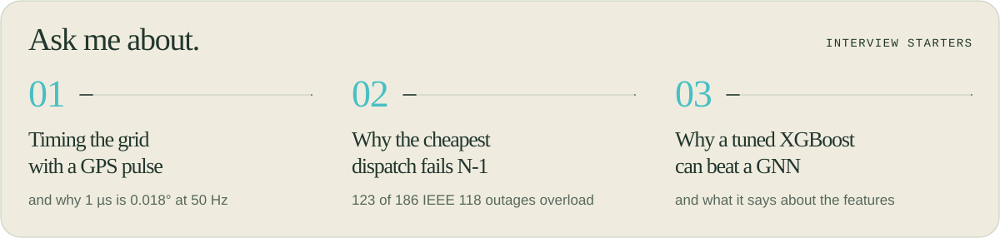</a>
</p>

<p align="right"><sub><a href="#top">↑ back to top</a></sub></p>

<a name="whats-next"></a>

<p>

</p>

<p>
</p>

<p align="center">
  <b>Stay tuned: I'm cooking more, and this board fills up as the work ships.</b><br>
  <sub>Hit <b>Follow</b> on this profile to catch the next release.</sub>
</p>

<p align="center">
  <a href="https://github.com/akeanti/akeanti/commits/main"></a>
</p>

<p align="right"><sub><a href="#top">↑ back to top</a></sub></p>

<a name="it-started-with-a-pc"></a>

<p>

</p>

I was **six when I opened my dad's old PC**. I wanted to know what was inside, and electronics became something I kept coming back to.

Now I study **Génie Électrique et Énergétique at EHTP**, after **CPGE MP** and the **CNC**. I'm interested in how measurements from real equipment can help us understand faults. That has led me from wireless power transfer and electrolyzer diagnostics to the grid itself: sensing it, solving it, and predicting how it fails.

<p align="center">
  <a href="#it-started-with-a-pc"></a>
  <a href="#my-mission"></a>
</p>

<a name="my-mission"></a>

### My mission

I want to help electrical systems waste less energy and catch problems earlier. That starts with understanding the hardware, getting useful measurements, and building models whose results people can make sense of. That's the kind of engineering I want to get good at.

<p>
</p>

<p align="right"><sub><a href="#top">↑ back to top</a></sub></p>

<a name="how-i-work"></a>

<p>

</p>

<p>
</p>

<p>
</p>

<p align="right"><sub><a href="#top">↑ back to top</a></sub></p>

<a name="code-in-the-open"></a>

<p>

</p>

<p>
<a href="https://github.com/akeanti?tab=repositories&amp;sort=updated"></a>
</p>

<p align="center"><sub>This board rebuilds itself. A <a href=".github/workflows/live-board.yml">GitHub Actions workflow</a> reads the GitHub API every six hours and commits only when something ships.</sub></p>

<a name="side-quests"></a>

<p>
<a href="https://github.com/akeanti/matlab-discord-rpc"></a>
</p>

| Project | What it is |
| :-- | :-- |
| [**swingbus**](https://github.com/akeanti/swingbus) | Power flow, N-1, DC-OPF with LMPs and cascade simulation in NumPy and SciPy, checked against PYPOWER. |
| [**nabd**](https://github.com/akeanti/nabd) | GPS-synced ESP32-S3 grid sensors: firmware, collector, live map and open dataset. Pre-release. |
| [**cascade-gnn**](https://github.com/akeanti/cascade-gnn) | GNNs vs XGBoost for cascading grid failures on PowerGraph, with edge attributions, CI tests and a Streamlit demo. |
| [**drpc**](https://github.com/akeanti/matlab-discord-rpc) | Discord Rich Presence for MATLAB and Simulink. [Website and docs](https://akeanti.xyz/matlab-discord-rpc/). |
| [**discord-hookmaster**](https://github.com/akeanti/discord-hookmaster) | A client-side tool to draft, preview and send Discord webhooks. |
| [**CPGE-Robotics**](https://github.com/akeanti/CPGE-Robotics) | Arduino projects from the prépa robotics club. |
| [**Maths wiki**](https://akeanti.github.io/Maths-Ain-t-Mathing-Wiki/) | My own maths notes, written up as a wiki. |
| [**LaTeX**](https://github.com/akeanti/LaTeX) · [**Advent of Code 2025**](https://github.com/akeanti/Advent-of-code-2025) | Templates and documents I've typeset; Python solutions with write-ups. |

<p align="right"><sub><a href="#top">↑ back to top</a></sub></p>

<a name="off-the-bench"></a>

<p>

</p>

I also enjoy competitive mathematics and metroidvania games. There's usually another problem to get absorbed in. I draw around the things I work on too; the signals and scenes below are illustrations, and the project results are in the notes above.

<sub>Somewhere in my repos there's [a commit dated to the first hour of Unix time](https://github.com/akeanti/1969). One small commit for a dev.</sub>

<details>
<summary><b>Open the art notebook</b> · animated studies</summary>

<p>
</p>

<p align="center">
  <a href="./assets/scope-study.svg"></a>
  <a href="./assets/pcb-study.svg"></a>
</p>

<p align="center">
  <a href="./assets/phase-study.svg"></a>
  <a href="./assets/resonance-study.svg"></a>
</p>

<p align="center">
  <a href="./assets/notebook-study.svg"></a>
  <a href="./assets/after-hours.svg"></a>
</p>

<p>
</p>

</details>

<p align="right"><sub><a href="#top">↑ back to top</a></sub></p>

<a name="recruiter-desk"></a>
<a name="lets-talk"></a>

<p>

</p>

I'm looking for a **summer 2027 internship (1–2 months)** in electrical and energy engineering, industrial AI, or OT cybersecurity. **Morocco or abroad**, on-site, hybrid, or remote. I work in **Arabic, French and English**. **CV available on request.**

<p align="center">
  <a href="mailto:akeantie@gmail.com?subject=CV%20request%3A%20%5Bcompany%5D%20internship&amp;body=Hi%20Akeanti%2C%0D%0A%0D%0ACould%20you%20send%20me%20your%20CV%3F%0D%0A%0D%0ACompany%3A%0D%0ARole%20%2F%20team%3A%0D%0AInternship%20dates%3A%0D%0ALocation%20%2F%20work%20mode%3A%0D%0A%0D%0AThanks%2C"></a>
  <a href="mailto:akeantie@gmail.com?subject=Call%20about%20a%20%5Bcompany%5D%20internship&amp;body=Hi%20Akeanti%2C%0D%0A%0D%0AI%20would%20like%20to%20set%20up%20a%20short%20call%20about%20an%20internship.%0D%0A%0D%0ACompany%3A%0D%0ARole%20%2F%20team%3A%0D%0AProposed%20times%20(with%20time%20zone)%3A%0D%0AVideo%20link%20or%20phone%3A%0D%0A%0D%0ABest%2C"></a>
  <a href="mailto:akeantie@gmail.com?subject=Internship%20opportunity%3A%20%5Brole%5D%20at%20%5Bcompany%5D&amp;body=Hi%20Akeanti%2C%0D%0A%0D%0AWe%20have%20an%20internship%20that%20could%20fit%20your%20profile.%0D%0A%0D%0ACompany%3A%0D%0ARole%3A%0D%0ADates%20and%20duration%3A%0D%0ALocation%20%2F%20work%20mode%3A%0D%0ALink%20to%20the%20posting%3A%0D%0A%0D%0ABest%2C"></a>
</p>

<p align="center"><sub>Each button opens a pre-filled email in your mail app. Fill in the blanks and send.</sub></p>

<details>
<summary><b>Recruiter FAQ</b> · quick answers</summary>

<br>

**When can you start, and for how long?**<br>
Summer 2027, for 1–2 months. Exact dates on request.

**Where can you work?**<br>
Morocco or abroad: on-site, hybrid or remote.

**Which languages do you work in?**<br>
Arabic (native), French (fluent) and English (professional).

**What are you studying?**<br>
Génie Électrique et Énergétique (electrical and energy engineering) at EHTP, after CPGE MP and the CNC.

**Which roles fit best?**<br>
Power systems and grid analytics first, then energy and hydrogen, power electronics, industrial AI, OT security and embedded work. See [Where I fit](#role-fit) for the evidence behind each.

**Can I verify your work?**<br>
Yes. Everything in [the grid stack](#the-grid-stack) is public, with CI. swingbus has a [validation report](https://github.com/akeanti/swingbus/blob/main/docs/validation.md) against PYPOWER, cascade-gnn has a [claim ledger](https://github.com/akeanti/cascade-gnn/blob/main/docs/CLAIMS.md), and nabd marks clearly what is a design target and what is done.

**Can I get your CV?**<br>
Yes: use **Request my CV** above and I'll send it by email.

</details>

<details>
<summary><b>Recruiter quick copy</b> · plain-text profile for your notes or ATS</summary>

```text
Akeanti | Electrical & energy engineering student, EHTP (GEE)
Background   CPGE MP · CNC
Looking for  Summer 2027 internship, 1–2 months
Fields       Electrical & energy engineering · power systems · industrial AI · OT security
Location     Morocco or abroad · on-site, hybrid or remote
Languages    Arabic (native) · French (fluent) · English (professional)
Highlights   swingbus: power flow, N-1, DC-OPF with LMPs in NumPy/SciPy; matches PYPOWER to 1e-13 pu,
             full N-1 of IEEE 118 in 8.3 ms, 95 tests on Linux/macOS/Windows
             nabd: GPS-synced ESP32-S3 synchrophasor nodes (IEEE C37.118), ~$59 BOM, KiCad, hardened CI
             cascade-gnn: 5 GNN variants vs XGBoost on PowerGraph, edge attributions, 14 tests in CI, Docker
             PEM electrolyzer fault diagnostics: MCSA-inspired features, XGBoost, SHAP
             Resonant WPT prototype: 23% efficiency at 34 kHz, R² = 0.992 vs Yates reference
             drpc: Discord Rich Presence for MATLAB/Simulink (MATLAB + C#), v1.1.0
Skills       Python, C, C++, C#, MATLAB/Simulink, NumPy, SciPy, PyTorch, PyTorch Geometric, XGBoost,
             SHAP, scikit-learn, ESP32-S3, ESP-IDF, PlatformIO, KiCad, Arduino, SCADA, Nmap,
             Wireshark, Git, Linux, Docker, GitHub Actions, LaTeX
Keywords     power systems, power flow, contingency analysis, N-1, optimal power flow, LMP,
             synchrophasor, PMU, grid frequency, ROCOF, grid resilience, cascading failures,
             fault diagnostics, hydrogen, PEM electrolyzer, wireless power transfer,
             graph neural networks, explainable AI, industrial AI, OT security, embedded systems
Contact      akeantie@gmail.com · github.com/akeanti · CV on request
```

</details>

<p>
<a href="mailto:akeantie@gmail.com"></a>
</p>

<p align="center">
  <a href="mailto:akeantie@gmail.com"><b>akeantie@gmail.com</b></a> &nbsp;·&nbsp;
  <a href="#the-grid-stack"><b>the grid stack</b></a> &nbsp;·&nbsp;
  <a href="#top"><b>back to top ↑</b></a>
</p>

<p align="center"><sub>Personal site, less formal: <a href="https://akeanti.xyz">akeanti.xyz</a></sub></p>
