<p>

</p>

<p align="center">
  <a href="mailto:akeantie@gmail.com?subject=CV%20request%3A%20%5Bcompany%5D%20internship&amp;body=Hi%20Akeanti%2C%0D%0A%0D%0ACould%20you%20send%20me%20your%20CV%3F%0D%0A%0D%0ACompany%3A%0D%0ARole%20%2F%20team%3A%0D%0AInternship%20dates%3A%0D%0ALocation%20%2F%20work%20mode%3A%0D%0A%0D%0AThanks%2C"></a>
  <a href="mailto:akeantie@gmail.com?subject=Internship%20opportunity"></a>
  <a href="https://akeanti.xyz"></a>
  <a href="#featured-work"></a>
</p>

<p align="center">
  First-year <b>electrical &amp; energy engineering</b> student at <b>EHTP</b>, after CPGE MP and the CNC.<br>
  I build complete systems, from GPS-synced sensors and ESP32 firmware to grid solvers and ML models,<br>
  and I check every result against a reference.<br>
  <b>Seeking a first-year internship (stage de 1re année) for summer 2027, 1–2 months.</b>
</p>

<p>

</p>

<a name="featured-work"></a>

<p>

</p>

<!-- PINNED:START · generated by .github/scripts/build_profile.py from my GitHub pins -->
<p align="center">
  <a href="https://github.com/akeanti/cascade-gnn"></a>
  <a href="https://github.com/akeanti/swingbus"></a>
</p>

<p align="center">
  <a href="https://github.com/akeanti/nabd"></a>
  <a href="https://github.com/akeanti/matlab-discord-rpc"></a>
</p>

<p align="center">
  <a href="https://github.com/akeanti/ariadne"></a>
  <a href="https://github.com/akeanti/malfoid"></a>
</p>
<!-- PINNED:END -->

<p>

</p>

<p>

</p>

<p>

</p>

<p>
<a href="mailto:akeantie@gmail.com?subject=CV%20request%3A%20%5Bcompany%5D%20internship&amp;body=Hi%20Akeanti%2C%0D%0A%0D%0ACould%20you%20send%20me%20your%20CV%3F%0D%0A%0D%0ACompany%3A%0D%0ARole%20%2F%20team%3A%0D%0AInternship%20dates%3A%0D%0ALocation%20%2F%20work%20mode%3A%0D%0A%0D%0AThanks%2C"></a>
</p>

<details>
<summary><b>Plain-text profile</b> · for your notes or ATS</summary>

```text
Akeanti | First-year electrical & energy engineering student, EHTP (GEE)
Background   CPGE MP · CNC
Looking for  First-year internship (stage de 1re année), summer 2027, 1–2 months
Fields       Power & energy systems · embedded systems · industrial AI · OT security
Location     Morocco or abroad · on-site, hybrid or remote
Languages    Arabic (native) · French (fluent) · English (professional)
Projects     swingbus     power flow, N-1, DC-OPF with LMPs in NumPy/SciPy; matches PYPOWER to 1e-13 pu,
                          full N-1 of IEEE 118 in 8.3 ms, 95 tests on Linux/macOS/Windows
             nabd         GPS-synced ESP32-S3 synchrophasor nodes (IEEE C37.118), ~$59 per node, KiCad, hardened CI
             cascade-gnn  5 graph neural networks vs XGBoost on PowerGraph (NeurIPS 2024), edge attributions, Docker
             ariadne      ESP32 micromouse: clothoid turns, time-optimal planning, 10 kHz physics sim, 115 tests, v3.0.0
             malfoid      ESP32-S3 gesture wand: on-device recognition (99.6% top-1), haptics, Home Assistant/MQTT
             drpc         Discord Rich Presence for MATLAB/Simulink (MATLAB + C#), v1.1.0
             Earlier      PEM electrolyzer fault diagnostics (XGBoost, SHAP); resonant WPT prototype, 23% at 34 kHz
Skills       Python, C, C++, C#, MATLAB/Simulink, NumPy, SciPy, PyTorch, XGBoost, SHAP, ESP32, ESP-IDF,
             FreeRTOS, PlatformIO, KiCad, MQTT, Git, Linux, Docker, GitHub Actions, LaTeX
Contact      akeantie@gmail.com · github.com/akeanti · akeanti.xyz · CV on request
```

</details>

<p align="center"><sub>The header, project cards and stats rebuild themselves from the GitHub API every 6 hours (<a href=".github/scripts/build_profile.py">script</a>).</sub></p>
